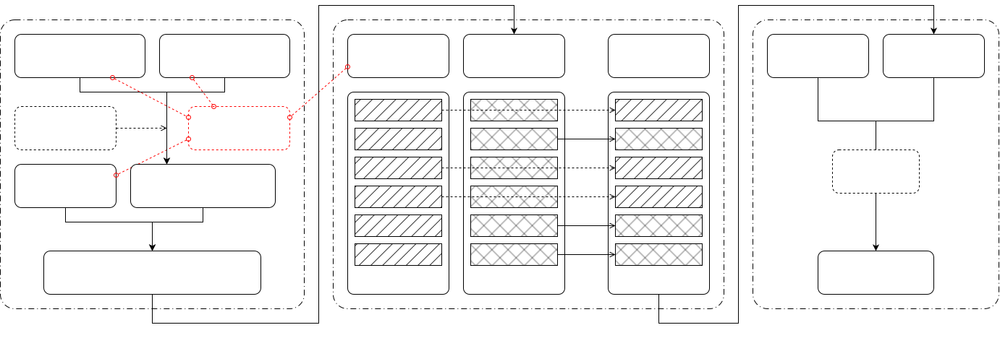

# 差分进化
Differential Evolution, DE

## 目标

考虑如下无约束优化问题：

$$
\min_{\mathbf{x}\in \mathbb R^D} f(\mathbf{x}),\qquad
f : \mathbb R^D \to \mathbb R,\quad
\mathbf{x} = (x_1,\dots,x_D) \mapsto f(\mathbf{x})
$$

差分进化算法用于在 $\mathbb R^D$ 中搜索使目标函数 $f(\mathbf{x})$ 取得最小值的参数向量 $\mathbf{x}$。

## 算法

### DE/rand/1/bin

由 Storn 和 Price 于 1997 年提出[^2]。

**一、种群**

使用 $\text{NP}$ 个 $D$ 维参数向量 $\{\mathbf{x}_{G,i}\}_{i=1}^\text{NP}$ 作为第 $G$ 代的种群。

其中：
- $\text{NP}$ 是种群大小，$\text{NP} \ge 4$，建议取 $5D \sim 10D$。
- $G = 0,\dots,G_\text{max}$。

**二、初始化**

算法开始前，初始化初代种群 $\{\mathbf{x}_{0,i}\}$。初代种群通常在整个参数空间内均匀随机抽取。如果对问题有先验知识，最好使初始种群范围覆盖疑似全局最优区域，以加快收敛。

选取控制参数：
- 差分权重/缩放因子 $F \in (0,2]$，常取 $F = 0.5$。
- 交叉概率 $\text{CR} \in [0,1]$，常取 $\text{CR} = 0.1$。

**三、迭代**

算法进行 $G_\text{max}$ 轮迭代。在第 $G+1$ 轮，对每一个 $i=1,\dots,\text{NP}$，由 $\mathbf{x}_{G,i}$ 经 **变异**、**交叉**、**选择** 生成下一代 $\mathbf{x}_{G+1,i}$。

  

**1. 变异**

对每个 $i$，从 $\{ 1,\dots,\text{NP} \}$ 中随机选取有序三元组 $(r_1,r_2,r_3)$，要求三者两两不同且均不等于 $i$。

更严谨地，令

$$
\Omega = \left\lbrace (r_1,r_2,r_3) \in \left( \{ 1,\dots,\text{NP} \} \setminus \{i\} \right)^3 \mid r_1 \neq r_2,\ r_2 \neq r_3,\ r_3 \neq r_1 \right\rbrace \\
(r_1,r_2,r_3) \sim \text{Uniform}(\Omega)
$$

定义变异向量 (mutant vector)

$$
\mathbf{v}_{G+1,i} = \mathbf{x}_{G,r_1} + F \cdot (\mathbf{x}_{G,r_2} - \mathbf{x}_{G,r_3})
$$

**2. 二项交叉**[^a]

定义试验向量 (trial vector)

$$
\mathbf{u}_{G+1,i} = (u_{G+1,i,1},\dots,u_{G+1,i,D})
$$

对每个 $i$ 生成判定随机数

$$
R_{i,j} \sim \text{Uniform}( [0,1) ),\qquad j = 1,\dots,D
$$

以及强制索引

$$
J_i \sim \text{Uniform}( \{ 1,\dots,D \} )
$$

然后构造

$$
u_{G+1,i,j} = \begin{cases}
v_{G+1,i,j}, & R_{i,j} \le CR \lor j = J_i, \\
x_{G,i,j}, & \text{otherwise}.
\end{cases},\qquad j = 1,2,\dots,D
$$

**3. 贪婪选择**

下一代定义为

$$
\mathbf{x}_{G+1,i} = \begin{cases}
\mathbf{u}_{G+1,i}, & f(\mathbf{u}_{G+1,i})<f(\mathbf{x}_{G,i}), \\
\mathbf{x}_{G,i}, & \text{otherwise}.
\end{cases}
$$

其中，$f$ 为待最小化的成本函数。

## 参考文献

[BibTeX](assets/de/de-refs.bib)

[^1]: Storn, Rainer & Price, Kenneth. (1995). Differential Evolution: A Simple and Efficient Adaptive Scheme for Global Optimization Over Continuous Spaces. Journal of Global Optimization. 23. [PDF - ResearchGate](https://www.researchgate.net/publication/246648860_Differential_Evolution_A_Simple_and_Efficient_Adaptive_Scheme_for_Global_Optimization_Over_Continuous_Spaces).

[^2]: Storn, Rainer & Price, Kenneth. (1997). Differential Evolution - A Simple and Efficient Heuristic for Global Optimization over Continuous Spaces. Journal of Global Optimization. 11. 341-359. 10.1023/A:1008202821328. [PDF - Metabolic economics](https://www.metabolic-economics.de/pages/seminar_theoretische_biologie_2007/literatur/schaber/Storn1997JGlobOpt11.pdf).

[^a]: 二项交叉，指对试验向量的每一个维度独立地进行随机选择。若不考虑强制维 $j = J_i$，那么 $D$ 个维度中取自变异向量的维数 $K$ 服从二项分布 $K \sim \text{Binomial}(D,\text{CR})$。
